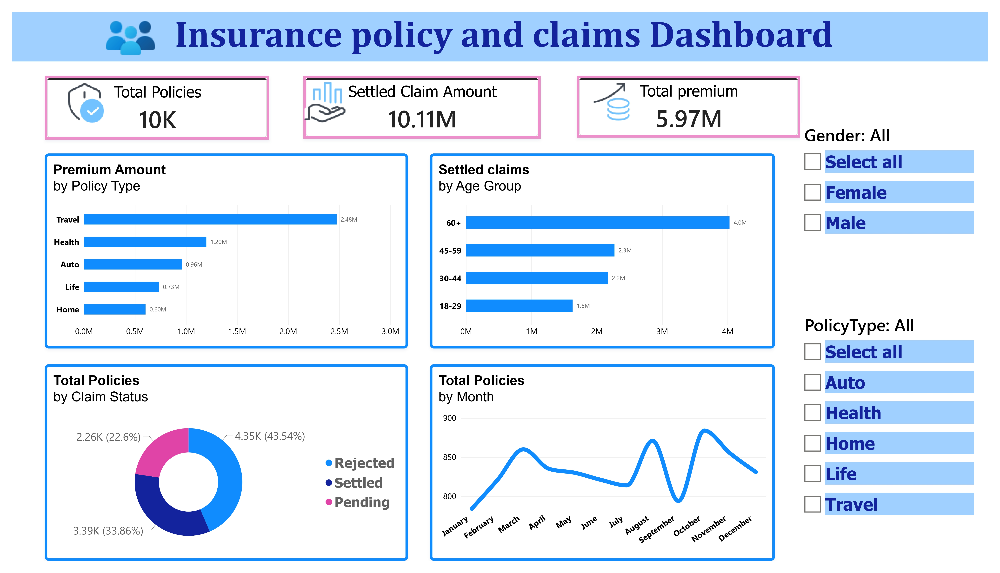

# Insurance Policy & Claims Analysis

Analysis of insurance policy and claims data using MySQL, Python (Pandas) and Power BI.

## Tools Used
- MySQL
- Python (Pandas) in Jupyter Notebook
- Power BI

## What I Did
- Cleaned the data in MySQL (removed duplicates, fixed date columns)
- Wrote SQL queries to analyze premium, policy types and claims
- Used Pandas to validate data and create new columns
- Built an interactive Power BI dashboard with KPIs and slicers

## Dashboard

## Files
- `insurance_queries.sql` - SQL queries
- `insuranceclean.ipynb` - Pandas analysis in Jupyter
